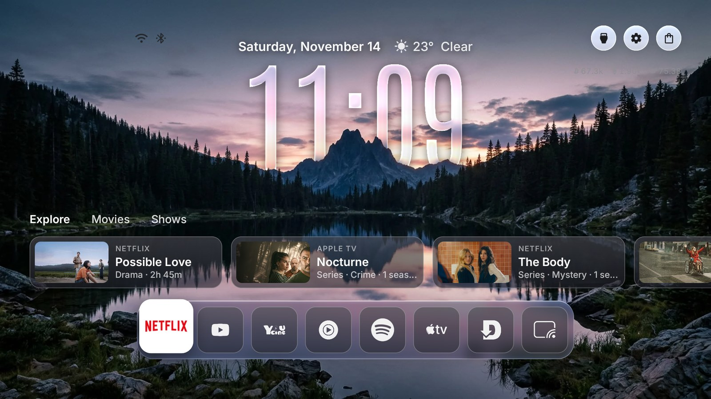

# MyOwnTV

A home screen for Android TV and Google TV. It keeps [Free My TV](https://github.com/simbasjungles/free-my-tv)'s layout and
features, and dresses them in the look of [Couch TV](https://github.com/Seagey/couch-tv): a scene wallpaper, a big
liquid-glass clock, and a dark glass dock whose icons light up in colour when focused.

Built for and tested on a Skyworth Google TV (Android TV 14, 1.8 GB RAM). Google TV's own home and setup wizard stay
installed, so nothing is disabled or removed.



## What you get
- **Scenes:** 13 wallpapers (choose which are on, and 5 minutes to 3 hours per picture) behind a glass clock, the date and weather.
- **Weather and holidays:** the wallpaper darkens and rains or snows with the weather outside; New Year, Valentine's Day,
  Easter, Halloween, Christmas, Ramadan / Eid and Diwali add their own decorations. Each can be switched off.
- **Picks:** trending titles from the streaming apps installed on your TV, as a row of glass cards (needs a free TMDB key).
  A free Watchmode key makes a pick open the title's own page in its app.
- **Search:** the round Search button at the top right. Type or say a title and see which of your TV's streaming apps carry it
  in your country; OK opens the app (on the title's own page with a Watchmode key), or saves it to My list (needs a free TMDB key).
- **Dock and drawer:** your apps as dark glass squares; Down opens inputs, shortcuts, weather and crypto prices.
- **Screensaver:** the same scenes, clock, weather effects and holiday decorations as the home screen, with a quote (in handwriting) from
  Kafka, Dostoevsky, Gibran, Darwish or Wilde at the bottom that changes every 2 minutes (works offline).
- **Updates:** MyOwnTV checks GitHub's releases once a week; when a newer one is ready a notice on the Home screen offers
  Install or Later (Android asks you to confirm the install).
- **Home button:** pressing Home from any app brings MyOwnTV straight back, with no flash of the Google home.

## Requirements
- Android TV or Google TV, Android 8 (API 26) or newer. The glass clock needs Android 13 or newer; older TVs get a flat clock.
- A computer with `adb` for the install, once. Developer options and USB / wireless debugging on the TV.

## Install
1. Download `MyOwnTV-<version>.apk` from the [Releases](../../releases) page.
2. On the TV: Settings > System > About, press OK on **Build** seven times; then Settings > System > Developer options >
   turn on **USB debugging** (or **Wireless debugging**).
3. From your computer:
   ```bash
   adb connect <TV IP>:5555          # Android 11 and newer with Wireless debugging: use the IP:port it shows
   adb install MyOwnTV-<version>.apk
   ```
4. Open **MyOwnTV** on the TV, go to **Home Screen** and choose **MyOwnTV**. Accept "Allow USB debugging?" (Always allow).
5. Turn on the **MyOwnTV** accessibility service when asked (Settings > Accessibility). It is what brings
   MyOwnTV back when you press Home, and when the TV wakes from standby.

To go back: open MyOwnTV, Home Screen, **Original**. Uninstalling the app also hands the home back to Google TV.

More in [docs/USAGE.md](docs/USAGE.md): settings, picks, keys, troubleshooting.

## Picks need your own free keys
The release APK carries no API keys. In MyOwnTV > Home Settings:
- **TMDB key** (free, [themoviedb.org/settings/api](https://www.themoviedb.org/settings/api)) turns the picks on.
- **Watchmode key** (optional, free, [watchmode.com](https://watchmode.com)) opens a title's own page in its app.

Without them the home screen works the same, just without the picks.

## Build it yourself
Needs a JDK 17+ and the Android SDK (build-tools 34+, platform android-34).

```bash
./build.sh              # first run creates config.properties (city, keys...); edit it, run again
./build.sh --generic    # no config and no keys: what the Releases APK is
adb install -r MyOwnTV.apk
```
Keys in `config.properties` are built into your own APK, so any app on the TV could read them: do not share that APK.
`config.properties`, `*.keystore` and APKs are in `.gitignore`: never commit them.

Tests (no Android needed): `tools/test/run.sh`. Scene images: `tools/copy_scenes.sh` and `tools/make_scenes.py`.

## Credits and licence
MIT, see [LICENSE](LICENSE). Built on Free My TV and Couch TV; scene photos from Pexels; fonts Inter and Antonio; weather
from Open-Meteo; picks from TMDB. Full list in [NOTICE.md](NOTICE.md). Not affiliated with or endorsed by Free My TV,
Couch TV, Google, TMDB or Watchmode.
